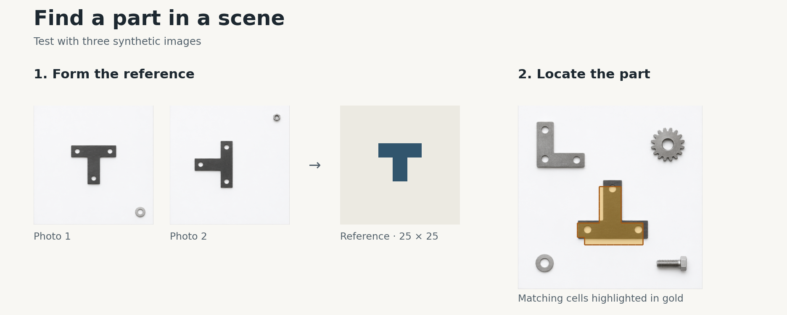

# Sphere Patterns

A 3D wave simulator that extracts a reference from two examples and uses it to find a shape in a new scene.

**[Open the interactive 3D lab](https://nicolashedoire.github.io/sphere-patterns/)**

**[Research protocol and latest results](RESEARCH.md)**



## Run a simulation in your browser

Choose an L or T, set its angle and position, then run the simulation. Rotate or zoom the sphere and scrub through the launch, return and probe readings. Run the same scene with the reference return disconnected to see which signal the match depends on.

The lab runs the network and alignment code in a browser worker. The playback shows samples taken from the simulated links. The browser inputs are synthetic silhouettes.

## The experiment

Two patterns enter the network as pulses. A junction compares their alignments and emits a signal **C** encoding the shared shape. C circulates through the sphere and returns to the comparator. The comparator then uses it to locate the shape in a new scene.

The comparator and input encoding are fixed. The examples supply the reference. Disconnecting the returning reference tests whether the detected shape depends on C.

## Results

| Experiment | Observation | Data |
| --- | --- | --- |
| L and T in one scene | Both templates are extracted from examples and recovered after translation and rotation. A lookalike matches four out of five cells. | [Two shapes](outputs/sphere-two-references-measurements.json) |
| T-shaped mechanical part | In a third synthetic image, the rotated part matches 41 of 42 template cells. The next candidate matches 37. | [Part recognition](outputs/sphere-mechanical-part-measurements.json) |
| Bolts and nuts | Three correct pairs among 18 candidates in one synthetic image. The distractor nuts sit at nearly the same distance. Cutting C removes all three matches. | [Diagonal assemblies](outputs/sphere-diagonal-assemblies-measurements.json) |

The mechanical-part benchmark uses 25 × 25 masks and quarter turns. The bolt-and-nut benchmark extracts silhouettes and axes from the pixels and compares relative positions. Both use synthetic overhead images of separated parts on a contrasting background.

### Intermediate rotations

| Benchmark | Quarter turns | Intermediate angles |
| --- | --- | --- |
| Wave network, three oblique scenes on a 25 × 25 grid | 0/3 | **3/3** at 15° intervals |
| Geometry benchmark, 18 oblique scenes with separated silhouettes | 0/18 | **18/18** at 2° intervals |

The wave network receives the same reference after **8,597 simulation steps**. Both angle settings recover the right-angle control and reject the distractor-only scene. Removing C from the comparator input eliminates recognition while keeping the physical pulse in the energy ledger. [Wave-network measurements](outputs/sphere-pattern-oblique-angle-measurements.json)

The geometry benchmark runs outside the sphere and isolates the effect of angular resolution. It rejects all 24 negative scenes at a fixed overlap threshold of 0.86. Mean orientation error on the 18 detected oblique shapes is 1.06°. The gap between the hardest positive and the closest lookalike is about 0.01 in overlap score. [Benchmark figure](outputs/sphere-angle-benchmark-figure.svg) · [Benchmark measurements](outputs/sphere-angle-benchmark-measurements.json)

### Partial occlusion

The same returning reference is compared against three partially covered T brackets. The ordinary overlap score misses all three. Scoring only visible cells recovers **two of three**. The third scene has two equally good poses, so the comparator abstains. It also abstains on the heavily covered target and both negative scenes. Cutting the return of C removes the measured match in the 58° scene.

The comparator receives a visibility mask supplied by the benchmark and requires at least 60% of the reference to remain visible. This tests recognition under known occlusion on fixed-scale synthetic silhouettes. [Occlusion figure](outputs/sphere-occlusion-figure.svg) · [Occlusion measurements](outputs/sphere-occlusion-measurements.json)

### Scale, clutter and real camera views

With a scale bank and local IoU, the wave comparator recovers **5 of 8 poses** in a fixed 12-scene stress test. It finds all five intact targets, misses all three occluded targets and raises no alarms in the four negative scenes. Using the cached probe reference directly reproduces the wave-return comparator's output. [Stress test](outputs/sphere-stress-figure.svg)

In the separate T-LESS pilot, the same geometric search misses all 12 true targets on grayscale crops, even with candidate boxes supplied. Dataset silhouettes recover two targets and also accept three distractors. [Camera scene panel](outputs/sphere-tless-scenes.png) · [Pilot protocol and results](RESEARCH.md#first-real-image-pilot)

## Reproduce the results

Run this command from the repository root with Node.js 24 and Bash.

```sh
bash scripts/replay.sh
```

The script runs the network controls, regenerates the measurements in a temporary directory and checks them byte for byte against the tracked outputs. The experiments use Node.js built-ins. Python is used for the optional mask and figure scripts.

To start the browser lab locally, build its engine and serve the lab directory. Open [localhost:8000](http://localhost:8000/) after the server starts.

```sh
node scripts/build-lab.cjs
python3 -m http.server 8000 --directory lab
```

- [Simulation source, inputs and parameters](work/)
- [Figures and measurements](outputs/)
- [Replay script](scripts/replay.sh)
