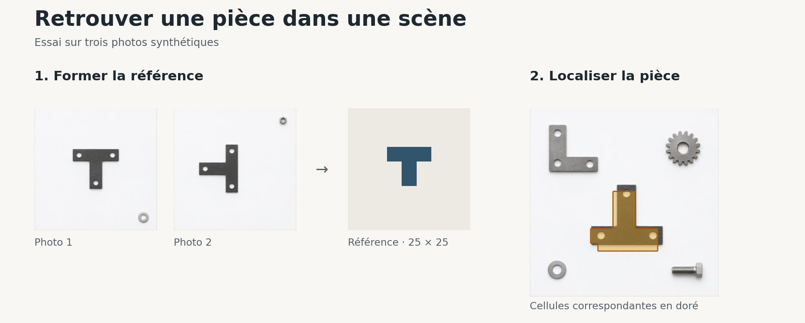

# Sphère Motifs

Un simulateur de propagation en 3D qui extrait une référence depuis deux exemples et la réutilise pour retrouver une forme dans une nouvelle scène.



## Ce que fait la sphère

Deux motifs entrent dans le réseau sous forme d'impulsions. Une jonction compare leurs alignements et émet un signal **C** qui encode ce qu'ils ont en commun. C circule dans la sphère. À son retour, la jonction compare cette référence à une nouvelle scène. Les sondes mesurent ce qui a circulé et où la correspondance apparaît.

Nous fournissons les règles de comparaison et l'encodage des entrées. Les deux exemples déterminent la référence. Les essais de coupure permettent de vérifier si la reconnaissance dépend effectivement du retour de C.

## Résultats reproduits

| Essai | Résultat observé | Mesures |
| --- | --- | --- |
| Un L et un T dans la même scène | Deux références formées à partir d'exemples, puis deux formes retrouvées après déplacement et rotation. Le leurre obtient 4 cases sur 5. | [L et T](outputs/sphere-deux-references-mesures.json) |
| Pièce mécanique en T | Sur une troisième image synthétique, la pièce retournée parmi d'autres objets obtient 41 cases sur les 42 du motif. Le second candidat en obtient 37. | [Pièce en T](outputs/sphere-mecanique-mesures.json) |
| Boulons et écrous | Trois appariements retrouvés parmi 18 dans une image synthétique. Les écrous leurres sont presque à la même distance des boulons. Couper le retour de C supprime les trois appariements. | [Boulons en diagonale](outputs/sphere-assemblages-diagonaux-mesures.json) |

Le test de la pièce en T utilise un masque de 25 × 25 et des rotations par quarts de tour. Les essais boulon–écrou extraient les silhouettes et les axes depuis les pixels, puis comparent les positions relatives. Ces résultats concernent des images générées, vues de dessus, avec des pièces séparées et un fond contrasté.

## Au-delà des quarts de tour

| Banc | Quarts de tour | Angles intermédiaires |
| --- | --- | --- |
| Dans la sphère · trois scènes obliques sur une grille de 25 × 25 | 0/3 | **3/3** avec un pas de 15° |
| Comparaison géométrique · 18 scènes obliques sur des silhouettes séparées | 0/18 | **18/18** avec un pas de 2° |

Dans la sphère, le même signal C revient au comparateur après **8 597 pas**. La jonction examine 24 orientations au lieu de quatre. Les deux variantes retrouvent la pièce à angle droit et rejettent la scène avec le leurre seul. Le contrôle retire C à l'entrée du comparateur tout en conservant le signal dans le bilan d'énergie. Il ne produit aucune reconnaissance. [Mesures dans la sphère](outputs/sphere-motif-angle-oblique-mesures.json)

Le banc géométrique s'exécute hors de la sphère. Il vérifie l'effet de la résolution angulaire sur 50 scènes synthétiques appariées, dont 24 sans cible. Avec un seuil de recouvrement fixé à 0,86, les 24 sont rejetées. L'erreur angulaire moyenne sur les 18 scènes obliques reconnues est de 1,06°. La marge entre la cible la plus difficile et le meilleur leurre est d'environ 0,01 au score de recouvrement. [Figure du banc](outputs/sphere-banc-angles-figure.svg) · [Mesures](outputs/sphere-banc-angles-mesures.json)

## Rejouer les expériences

Avec Node.js 24 et Bash, depuis la racine du dépôt :

```sh
bash scripts/rejouer.sh
```

Le script recalcule les 15 rapports dans un dossier temporaire et les compare octet pour octet aux mesures versionnées. Les simulations utilisent uniquement les modules intégrés à Node.js. Les masques, les images d'entrée et les paramètres sont versionnés. Les scripts de rendu des figures utilisent Python et sont facultatifs pour rejouer les mesures.

- [Sources et paramètres](work/)
- [Images et mesures](outputs/)
- [Script de rejeu](scripts/rejouer.sh)
